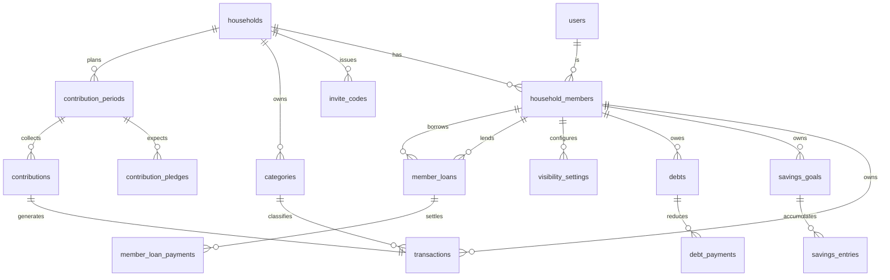

# Data Model — Phase 1

Postgres 16. All Phase 1 tables. Later-phase tables are not created yet.

Related: `docs/superpowers/specs/2026-09-02-family-hub-design.md` §6

---

## 1. Conventions

| Convention | Rule |
| ---------- | ---- |
| Primary keys | `UUID`, generated application-side (UUIDv7 for time-ordered locality). |
| Money | `amount_minor BIGINT NOT NULL` + currency from the owning household. **Never `FLOAT`, `REAL`, or `DOUBLE PRECISION`.** COP has 0 minor units, so `amount_minor` holds whole pesos. |
| Money sign | `CHECK (amount_minor > 0)` everywhere. Direction lives in a kind column. |
| Financial dates | `DATE`. |
| Audit fields | `created_at`, `updated_at` as `TIMESTAMPTZ NOT NULL DEFAULT now()`. |
| Deletion | Hard delete with explicit `ON DELETE` behaviour. No soft-delete flags in Phase 1. |
| Tenancy | Every finance table carries `household_id` even when reachable through a join. Denormalized deliberately: it makes the scoping filter unmissable and indexable. |
| Naming | `snake_case`, plural tables, singular columns, `_id` suffix on FKs. |
| Enums | Postgres native `ENUM` types, mirrored as Python `StrEnum`. |

---

## 2. Enum types

```sql
CREATE TYPE member_role         AS ENUM ('admin','adult','teen','guest');
CREATE TYPE member_status       AS ENUM ('active','invited','inactive');
CREATE TYPE category_kind       AS ENUM ('income','expense');
CREATE TYPE transaction_kind    AS ENUM ('income','expense');
CREATE TYPE transaction_source  AS ENUM ('manual','contribution');
CREATE TYPE savings_entry_kind  AS ENUM ('deposit','withdrawal');
CREATE TYPE debt_creditor_type  AS ENUM ('bank','family','credit_card','addi','other');
CREATE TYPE debt_status         AS ENUM ('active','paid','cancelled');
CREATE TYPE loan_status         AS ENUM ('pending','partially_paid','paid','cancelled');
CREATE TYPE visibility_module   AS ENUM ('income','expenses','savings','debts');
CREATE TYPE visibility_level    AS ENUM ('private','summary','public');
CREATE TYPE period_status       AS ENUM ('open','closed');
```

---

## 3. Entity relationships



---

## 4. Identity and household

### `users`

| Column | Type | Notes |
| ------ | ---- | ----- |
| `id` | `UUID PK` | |
| `email` | `CITEXT NOT NULL UNIQUE` | Case-insensitive. |
| `password_hash` | `TEXT NOT NULL` | argon2id. |
| `display_name` | `TEXT NOT NULL` | |
| `photo_url` | `TEXT NULL` | |
| `birth_date` | `DATE NULL` | Age is **derived**, never stored (FR-M1-06). |
| `created_at`, `updated_at` | `TIMESTAMPTZ` | |

### `households`

| Column | Type | Notes |
| ------ | ---- | ----- |
| `id` | `UUID PK` | |
| `name` | `TEXT NOT NULL` | "Familia Hernández". |
| `currency` | `CHAR(3) NOT NULL DEFAULT 'COP'` | ISO 4217. |
| `timezone` | `TEXT NOT NULL DEFAULT 'America/Bogota'` | IANA. Period boundaries computed here. |
| `created_by` | `UUID NOT NULL REFERENCES users` | |
| `created_at`, `updated_at` | `TIMESTAMPTZ` | |

### `household_members`

| Column | Type | Notes |
| ------ | ---- | ----- |
| `id` | `UUID PK` | The member id used throughout finance tables. |
| `household_id` | `UUID NOT NULL REFERENCES households ON DELETE CASCADE` | |
| `user_id` | `UUID NOT NULL REFERENCES users ON DELETE RESTRICT` | `RESTRICT`: deleting a user must not silently erase a family's financial history. |
| `role` | `member_role NOT NULL` | |
| `relationship` | `TEXT NULL` | Free text: "Papá", "Mamá", "Hermano". |
| `status` | `member_status NOT NULL DEFAULT 'active'` | |
| `joined_at` | `TIMESTAMPTZ NOT NULL DEFAULT now()` | |

- `UNIQUE (household_id, user_id)`
- `UNIQUE (user_id)` — enforces one household per user in Phase 1 (FR-M1-02).
  Dropping this constraint is the whole migration to multi-household later.
- **INV-R-01 (at least one active admin) is enforced in the service layer**, in
  the same transaction as any role change or deactivation, using
  `SELECT ... FOR UPDATE` on the household row. A partial unique index cannot
  express "at least one".

### `invite_codes`

| Column | Type | Notes |
| ------ | ---- | ----- |
| `id` | `UUID PK` | |
| `household_id` | `UUID NOT NULL REFERENCES households ON DELETE CASCADE` | |
| `code` | `TEXT NOT NULL UNIQUE` | 8 chars, `ABCDEFGHJKMNPQRSTUVWXYZ23456789` — no `0 O 1 I L` (FR-M1-03). |
| `role_granted` | `member_role NOT NULL` | |
| `expires_at` | `TIMESTAMPTZ NOT NULL` | Default now + 7 days. |
| `max_uses` | `INT NOT NULL DEFAULT 1 CHECK (max_uses > 0)` | |
| `uses` | `INT NOT NULL DEFAULT 0 CHECK (uses >= 0 AND uses <= max_uses)` | |
| `revoked_at` | `TIMESTAMPTZ NULL` | |
| `created_by` | `UUID NOT NULL REFERENCES household_members` | |

Redemption increments `uses` under `SELECT ... FOR UPDATE`; the `CHECK` is the
backstop against a concurrent over-redemption.

### `refresh_tokens`

| Column | Type | Notes |
| ------ | ---- | ----- |
| `id` | `UUID PK` | |
| `user_id` | `UUID NOT NULL REFERENCES users ON DELETE CASCADE` | |
| `token_hash` | `TEXT NOT NULL UNIQUE` | SHA-256 of the token. The raw value is never stored. |
| `expires_at` | `TIMESTAMPTZ NOT NULL` | |
| `revoked_at` | `TIMESTAMPTZ NULL` | Set on rotation, so reuse of an old token is detectable. |

---

## 5. Personal finance

### `categories`

| Column | Type | Notes |
| ------ | ---- | ----- |
| `id` | `UUID PK` | |
| `household_id` | `UUID NOT NULL REFERENCES households ON DELETE CASCADE` | |
| `kind` | `category_kind NOT NULL` | |
| `name` | `TEXT NOT NULL` | |
| `icon` | `TEXT NULL` | |
| `is_system` | `BOOLEAN NOT NULL DEFAULT false` | System categories cannot be deleted, only archived (FR-M2-02). |
| `archived_at` | `TIMESTAMPTZ NULL` | |

- `UNIQUE (household_id, kind, name)`
- Seeded per household on creation (FR-M2-01): income — Salario, Negocio,
  Regalos, Otros; expense — Transporte, Comida, Educación, Entretenimiento,
  Salud, Otros. Plus one system expense category **`Aporte al hogar`** used by
  FR-M4-05.

### `transactions`

| Column | Type | Notes |
| ------ | ---- | ----- |
| `id` | `UUID PK` | |
| `household_id` | `UUID NOT NULL REFERENCES households ON DELETE CASCADE` | |
| `member_id` | `UUID NOT NULL REFERENCES household_members ON DELETE RESTRICT` | The owner. |
| `kind` | `transaction_kind NOT NULL` | |
| `category_id` | `UUID NOT NULL REFERENCES categories ON DELETE RESTRICT` | |
| `amount_minor` | `BIGINT NOT NULL CHECK (amount_minor > 0)` | |
| `occurred_on` | `DATE NOT NULL` | |
| `note` | `TEXT NULL` | |
| `source` | `transaction_source NOT NULL DEFAULT 'manual'` | |
| `source_id` | `UUID NULL` | The `contributions.id` when `source = 'contribution'`. |
| `created_at`, `updated_at` | `TIMESTAMPTZ` | |

- `CHECK ((source = 'manual' AND source_id IS NULL) OR (source <> 'manual' AND source_id IS NOT NULL))`
- Rows with `source <> 'manual'` are **derived records**: the API rejects direct
  edit and delete with `409 derived_record` (FR-M2-05).
- Index: `(household_id, member_id, occurred_on DESC)` — the shape of every
  ledger and summary query.
- Index: `(household_id, member_id, kind, occurred_on)` — period totals.

### `savings_goals`

`id` · `household_id` · `member_id` · `name TEXT NOT NULL` ·
`target_amount_minor BIGINT NOT NULL CHECK (> 0)` · `target_date DATE NULL` ·
`archived_at TIMESTAMPTZ NULL` · audit.

**No stored balance column.** Balance is `SUM(deposits) - SUM(withdrawals)`
(FR-M2-08). A stored balance is a second source of truth waiting to disagree.

### `savings_entries`

`id` · `household_id` · `goal_id REFERENCES savings_goals ON DELETE CASCADE` ·
`kind savings_entry_kind NOT NULL` ·
`amount_minor BIGINT NOT NULL CHECK (> 0)` · `occurred_on DATE NOT NULL` ·
`note TEXT NULL` · audit.

Index: `(goal_id, occurred_on)`.

### `debts`

`id` · `household_id` · `member_id` ·
`creditor_type debt_creditor_type NOT NULL` · `creditor_label TEXT NOT NULL` ·
`principal_minor BIGINT NOT NULL CHECK (> 0)` ·
`annual_interest_rate NUMERIC(5,2) NULL` ·
`due_day SMALLINT NULL CHECK (due_day BETWEEN 1 AND 31)` ·
`status debt_status NOT NULL DEFAULT 'active'` · audit.

Outstanding is derived: `principal_minor - SUM(debt_payments.amount_minor)`
(FR-M2-11). `status` transitions to `paid` in the service layer when the
derived outstanding reaches zero.

### `debt_payments`

`id` · `household_id` · `debt_id REFERENCES debts ON DELETE CASCADE` ·
`amount_minor BIGINT NOT NULL CHECK (> 0)` · `paid_on DATE NOT NULL` ·
`note TEXT NULL` · audit.

---

## 6. Loans between members

The "one fact, one row" table. This is what makes the two sides unable to
disagree (FR-M2-13).

### `member_loans`

| Column | Type | Notes |
| ------ | ---- | ----- |
| `id` | `UUID PK` | |
| `household_id` | `UUID NOT NULL REFERENCES households ON DELETE CASCADE` | |
| `lender_member_id` | `UUID NOT NULL REFERENCES household_members ON DELETE RESTRICT` | |
| `borrower_member_id` | `UUID NOT NULL REFERENCES household_members ON DELETE RESTRICT` | |
| `amount_minor` | `BIGINT NOT NULL CHECK (amount_minor > 0)` | |
| `lent_on` | `DATE NOT NULL` | |
| `due_on` | `DATE NULL` | |
| `status` | `loan_status NOT NULL DEFAULT 'pending'` | |
| `note` | `TEXT NULL` | |

- `CHECK (lender_member_id <> borrower_member_id)`
- Both parties must belong to `household_id`; enforced in the service layer.
- Neither party may be a `guest` (FR-M2-15); service layer.
- Index: `(household_id, lender_member_id)` and `(household_id, borrower_member_id)`.

### `member_loan_payments`

`id` · `household_id` · `loan_id REFERENCES member_loans ON DELETE CASCADE` ·
`amount_minor BIGINT NOT NULL CHECK (> 0)` · `paid_on DATE NOT NULL` ·
`recorded_by_member_id` · audit.

Outstanding is derived. `status` moves `pending → partially_paid → paid` in the
service layer as payments land.

---

## 7. Household contribution

### `contribution_periods`

`id` · `household_id` · `period_month DATE NOT NULL` (always the 1st) ·
`goal_amount_minor BIGINT NOT NULL CHECK (> 0)` ·
`status period_status NOT NULL DEFAULT 'open'` · audit.

- `UNIQUE (household_id, period_month)` — one period per month (FR-M4-01).
- `CHECK (EXTRACT(DAY FROM period_month) = 1)`

### `contribution_pledges`

`id` · `household_id` · `period_id REFERENCES contribution_periods ON DELETE CASCADE` ·
`member_id` · `expected_amount_minor BIGINT NOT NULL CHECK (> 0)`.

`UNIQUE (period_id, member_id)`.

### `contributions`

| Column | Type | Notes |
| ------ | ---- | ----- |
| `id` | `UUID PK` | |
| `household_id` | `UUID NOT NULL` | |
| `period_id` | `UUID NOT NULL REFERENCES contribution_periods ON DELETE RESTRICT` | |
| `member_id` | `UUID NOT NULL REFERENCES household_members ON DELETE RESTRICT` | |
| `amount_minor` | `BIGINT NOT NULL CHECK (amount_minor > 0)` | |
| `paid_on` | `DATE NOT NULL` | |
| `note` | `TEXT NULL` | |
| `expense_transaction_id` | `UUID NOT NULL UNIQUE REFERENCES transactions ON DELETE RESTRICT` | The mirrored personal expense (FR-M4-05). |

**The mirroring contract.** Creating a contribution writes the `transactions`
row and the `contributions` row **in one database transaction**. Deleting one
deletes both, in one transaction (FR-M4-06). `ON DELETE RESTRICT` on
`expense_transaction_id` guarantees the transaction cannot be removed out from
under the contribution — deletion must go through the service, which unlinks
and removes both in the correct order.

`UNIQUE` on `expense_transaction_id` guarantees one contribution never claims
another's expense.

---

## 8. Visibility

### `visibility_settings`

| Column | Type | Notes |
| ------ | ---- | ----- |
| `id` | `UUID PK` | |
| `household_id` | `UUID NOT NULL` | |
| `member_id` | `UUID NOT NULL REFERENCES household_members ON DELETE CASCADE` | |
| `module` | `visibility_module NOT NULL` | |
| `level` | `visibility_level NOT NULL` | |
| `updated_at` | `TIMESTAMPTZ NOT NULL DEFAULT now()` | |

- `UNIQUE (member_id, module)`
- Four rows seeded on membership creation: `income`, `expenses`, `savings` →
  `summary`; `debts` → `private` (FR-M3-03).
- A missing row resolves to the module default, **never to `public`**
  (VR-05, fail closed).

---

## 9. Migration order

Alembic revisions, in dependency order. One concern per revision.

1. `enums` — all `CREATE TYPE` statements, plus the `citext` extension.
2. `users`, `refresh_tokens`
3. `households`, `household_members`, `invite_codes`
4. `categories` (+ the per-household seeding function)
5. `transactions`
6. `savings_goals`, `savings_entries`
7. `debts`, `debt_payments`
8. `member_loans`, `member_loan_payments`
9. `contribution_periods`, `contribution_pledges`, `contributions`
10. `visibility_settings`
11. `indexes` — the composite read-path indexes listed above

Every revision must have a working `downgrade()`. Every revision is applied and
rolled back once in CI against an empty database before it is considered done.

---

## 10. Invariants not expressible in DDL

These live in the service layer, each inside the transaction that could violate
it, each with a named test.

| ID | Invariant |
| -- | --------- |
| INV-R-01 | A household always has ≥ 1 active admin. |
| INV-D-01 | A contribution and its mirrored expense are created and deleted atomically. |
| INV-D-02 | Both loan parties belong to the same household as the loan, and neither is a guest. |
| INV-D-03 | Every finance row's `household_id` matches its member's `household_id`. |
| INV-D-04 | A transaction's `category_id` belongs to the same household and matches the transaction's `kind`. |
| INV-D-05 | Invite redemption never pushes `uses` past `max_uses` under concurrency. |
| INV-D-06 | A derived transaction (`source <> 'manual'`) is never edited or deleted through the transactions API. |
